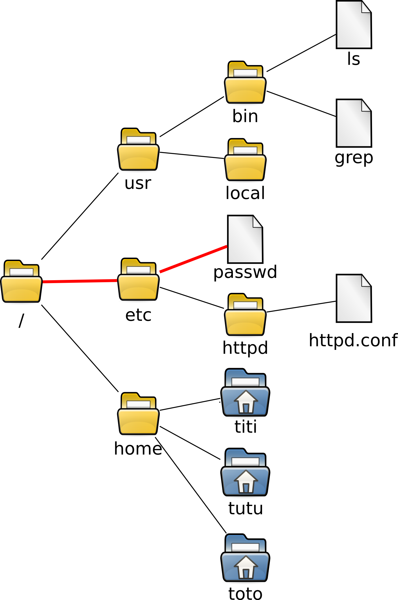
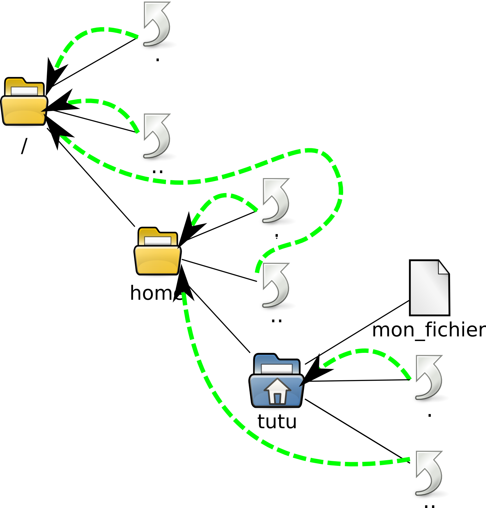
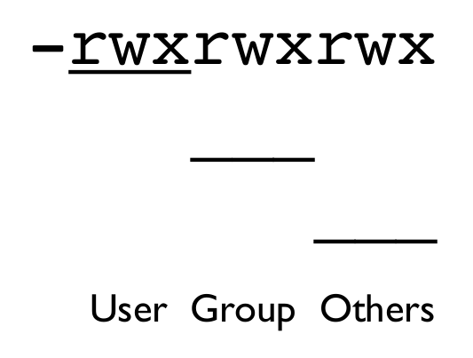
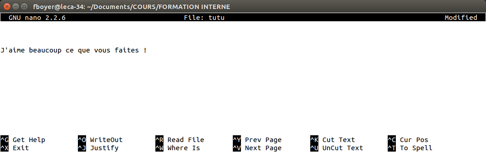
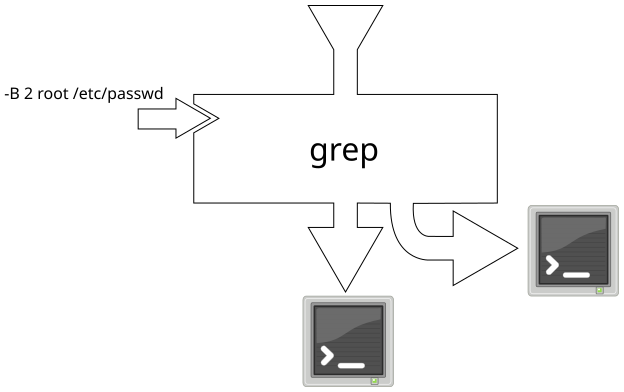
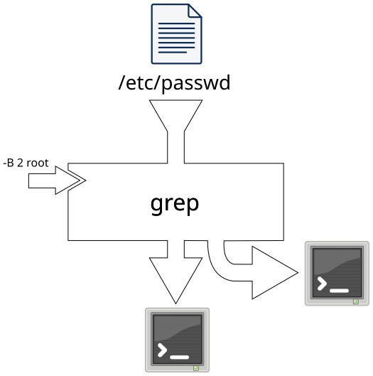
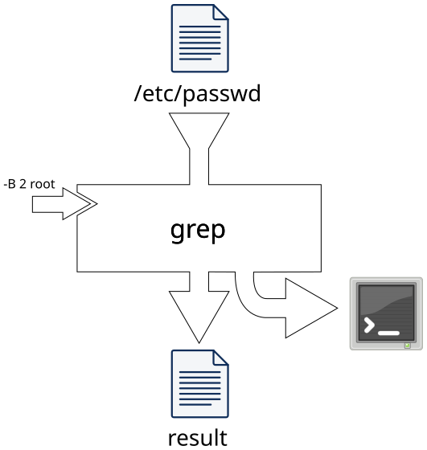
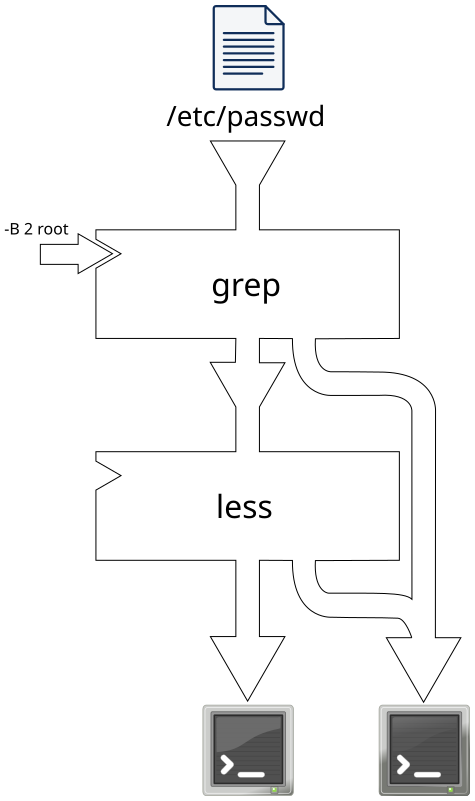
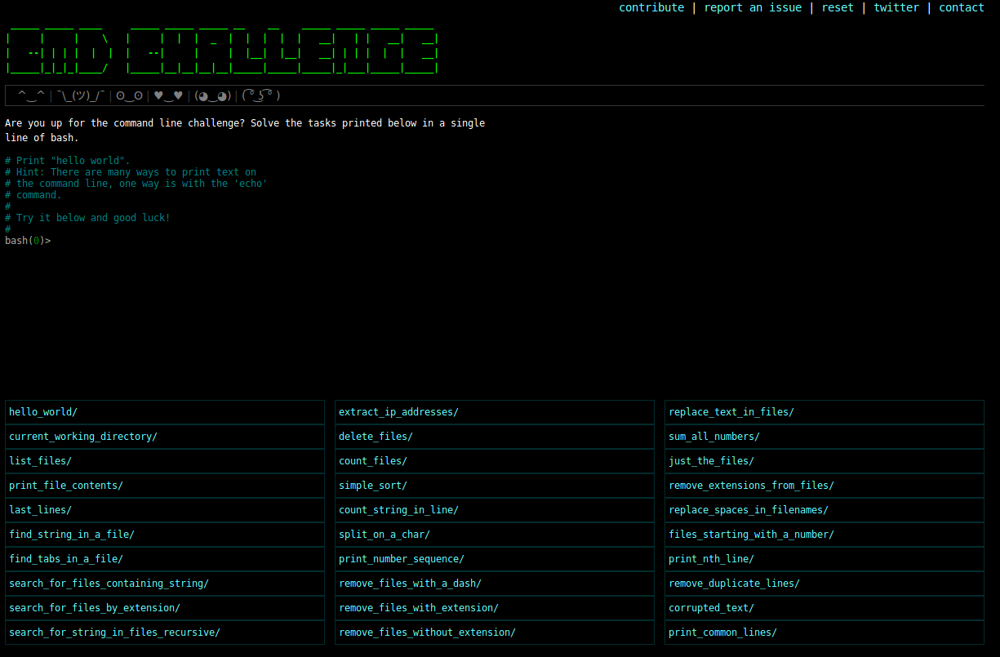

---
title: |
    DNA metabarcoding School
    Unix Basics
author: frederic.boyer@univ-grenoble-alpes.fr
format: 
  revealjs:
    css: ../../slides.css
    transition: slide
    scrollable: true
    theme: beige 
    html-math-method: mathjax
---

# Introduction to Unix


## Interacting with a UNIX computer


### The command shell endless loop

{ width=80% }


## Bash

The basic command interpreter on the machine (and most often found on a linux machine) is `bash`.


> Bash is a command processor that typically runs in a text window, where the user types commands that cause actions. Bash can also read commands from a file, called a script. Like all Unix shells, it supports filename globbing (wildcard matching), piping, here documents, command substitution, variables and control structures for condition-testing and iteration. The keywords, syntax and other basic features of the language were all copied from sh. Other features, e.g., history, were copied from csh and ksh. Bash is a POSIX shell, but with a number of extensions.
> 
> [wikipedia:bash](https://en.wikipedia.org/wiki/Bash_%28Unix_shell%29)


## RTFM !

> RTFM is an initialism for the expression "read the fucking manual" or, in the context of the Unix computer operating system, "read the fucking man page". The RTFM comment is usually expressed when the speaker is irritated by another person's question or lack of knowledge. It refers to either that person's inability to read a technical manual, or to their perceived laziness in not doing so first, before asking the question.
>
> [wikipedia:RTFM](https://en.wikipedia.org/wiki/RTFM)


The official `bash` documentation: [documentation]( https://www.gnu.org/software/bash/manual/ )


## RTFM: getting help with `man`

> A man page (short for manual page) is a form of software documentation usually found on a Unix or Unix-like operating system. Topics covered include computer programs (including library and system calls), formal standards and conventions, and even abstract concepts. A user may invoke a man page by issuing the man command.
>
> [wikipedia:man page](https://en.wikipedia.org/wiki/Man_page)

| Useful command       | What it does                            |
|----------------------|-----------------------------------------|
| `man <command>`      | prints manual for the `command` command |

For example, to get the manual page for the `man` command:

```bash
man man
```

## RTFM: getting help with `-h` or `--help`

When there is no man page associated to a command one can use the `-h` or `--help` options:

For example, to get the help associated to the `man` command:

```bash
man --help
```

# Filesystem -- basic commands and streams

{ width=40% }

## Absolute path

> An absolute or full path points to the same location in a file system, regardless of the current working directory. To do that, it must include the root directory.
>
> [wikipedia:Path(computing)](https://en.wikipedia.org/wiki/Path_(computing))

The root of the filesystem is designed by `/`.

The different part of the path are separated by `/`.

## Absolute path


{ width=30% }

The red path is : `/etc/passwd`

## Relative path

> By contrast, a relative path starts from some given working directory, avoiding the need to provide the full absolute path.
>
> [wikipedia:Path (computing)]( https://en.wikipedia.org/wiki/Path_(computing) )

## Special directories :
- `~` : *home directory* for the current user
- `~name` : *home directory* for user *name*
- `.` : Current directory
- `..` : Parent directory

{ width=30% }


## Useful commands to interact with the filesystem

| Useful commands            | What it does                |
|----------------------------|-----------------------------|
| `pwd`                      | print working directory     |
| `cd <directory>`           | change directory            |
| `mkdir <filename>`         | create directory            |
| `ls <filename>`            | list files and directories  |
| `touch <filename>`         | create or touch a file      |
| `cp <filename> <filename>` | copy files or directories   |
| `mv <filename> <filename>` | move files or directories   |
| `rm <filename>`            | remove files or directories |


## Permissions

Files and directories are assigned permissions or access rights to specific users and groups of users. The permissions control the ability of the users to view, change, navigate, and execute the contents of the file system.

> Permissions on Unix-like systems are managed in three distinct scopes or classes. 
> These scopes are known as user, group, and others.
>
> [wikipedia: unix permissions](https://en.wikipedia.org/wiki/File_system_permissions#Traditional_Unix_permissions)

## Permissions

 { width=10% }

> The modes indicate which permissions are to be granted or taken away from the specified classes. 
> There are three basic modes which correspond to the basic permissions:
> 
> | Mode | Name	   | Description                                |
> |------|---------|--------------------------------------------|
> |  r	 | read	   | read a file or list a directory's contents |
> |  w	 | write   | write to a file or directory               |
> |  x	 | execute | execute a file or recurse a directory tree |
>
> [wikipedia:modes](https://en.wikipedia.org/wiki/Modes_(Unix))

## View and change permissions

| Useful commands              | What it does       |
|------------------------------|--------------------|
| `ls -l`                      | view permissions   |
| `chmod <options> <filename>` | change permissions |


## For example:

```bash
fboyer@obitools:~/$ ls -l index.html
-rw-rw-r-- 1 fboyer fboyer 3101 déc. 21 17:09 index.html
fboyer@obitools:~/$ chmod 500 index.html
fboyer@obitools:~/$ ls -l index.html
-r-x------ 1 fboyer fboyer 3101 déc. 21 17:09 index.html
```


# Commands to work with text

## Visualize the content of a file

| Useful commands    | What it does                           |
|--------------------|----------------------------------------|
| `less <filename>`  | utility to explore text files          |


## The `less` command

| shortcut              | What it does                              |
|-----------------------|-------------------------------------------|
| `h`                   | display help                              |
| `q`                   | quit                                      |
| `/`                   | search for a regular pattern              |
| `n`                   | for the Next occurence of the pattern     |
| `shift-n`             | for the previous occurence of the pattern |
| `arrows` and `space`  | to navigate                               |
| `g` and `G`           | go to top and end of the file             |

## Edit a text file

| Useful commands    | What it does       |
|--------------------|--------------------|
| `nano <filename>`  | Simple text editor |


{ width=100% }

## Basic `Unix` commands to manipulate text files

| Useful commands               | What it does                                                     |
|-------------------------------|------------------------------------------------------------------|
| `cat <filename>`              | output the content of `filename` file                            |
| `head [-<N>] <filename>`      | output the first `N` lines of `filename`                         |
| `tail [-<N>] <filename>`      | output the last `N` lines of `filename`                          |
| `sort [options] <filename>`   | sort the content of `filename` and output it                     |
| `cut [options] <filename>`    | extract some column from `filename` and output it                |
| `diff [options] <filenames>`  | compare files line by line and output the differences            |

## Basic `Unix` commands to manipulate text files

| Useful commands               | What it does                                                     |
|-------------------------------|------------------------------------------------------------------|
| `join [options] <filename> <filename>` | join files on the basis of column content               |
| `paste [options] <filenames>` | paste files line by line                                         |
| `wc [options] <filenames>`    | count characters, words or lines                                 |
| `find <directory> [options]`  | search files (Ex: `find . -name '*.txt'`)                        |
| `sed <command> <filename>`    | process file line by line for basic editing                      |
| `grep [options] <regular expression> <filenames>` | search files for a *pattern*                 |
| `egrep [options] <extended regular expression> <filenames>` | similar as using the `-e` option of `grep` |

## `Unix` streams

> In computer programming, standard streams are pre-connected input and output channels that allow communication between a computer program and its environment when the program begins execution. 
> The three I/O connections are called standard input (`stdin`), standard output (`stdout`) and standard error (`stderr`).

A basic `Unix` command: Piping a stream into another command> [wikipedia:streams](https://en.wikipedia.org/wiki/Standard_streams)

## A basic `Unix` command

{ width=50% }

standard input (`stdin`), standard output (`stdout`), standard error (`stderr`) and parameters don't need to be specified.

By default, `stdin` is empty, `stdout` and `stderr` output their content to the terminal.

## A basic `Unix` command: Specifying parameters

#### Exemples: Parameters

```bash
grep -B 2 root /etc/passwd
```

{ width=60% }

## A basic `Unix` command: Sending the content of a text file to the standard input

Most of the commands that handle text can, if no file is given as a parameter, use the content of `stdin`.

#### Exemples: Redirecting the standard input

```bash
grep -B 2 root < /etc/passwd
```

{ width=40% }

## A basic `Unix` command: Creating a text file from the output of a command

### Exemples: Redirecting the standard output

```bash
# > create or replace file
# >> append to file
grep -B 2 root < /etc/passwd > result
```

{ width=20% }

## A basic `Unix` command: Piping a stream into another command

### Exemples: Redirecting the standard output

```bash
# > create or replace file
# >> append to file
grep -B 2 root < /etc/passwd | less
```

{ width=20% } 

## RTFM: Bash redirections

[Bash redirections](https://www.gnu.org/software/bash/manual/html_node/Redirections.html)

# The bash command challenge !


{ width=80% }


[I accept the challenge !](https://cmdchallenge.com/)


