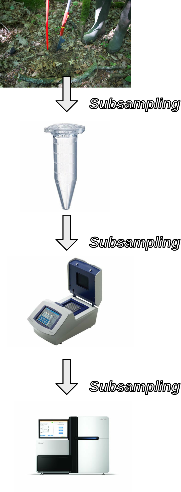
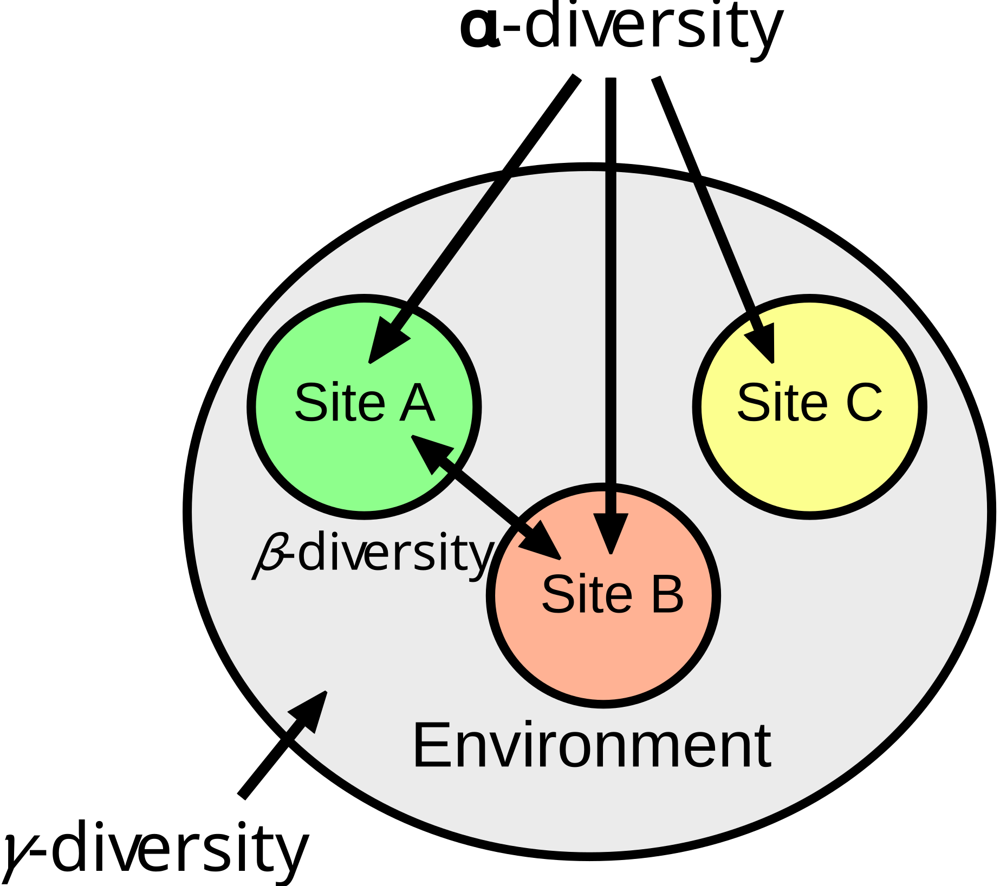
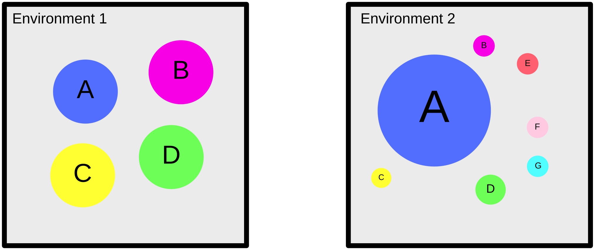
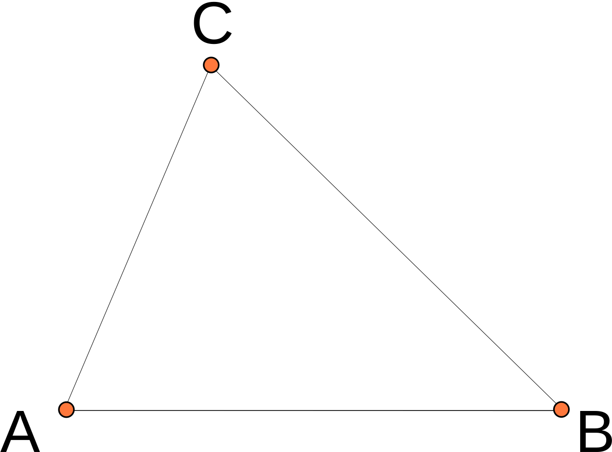
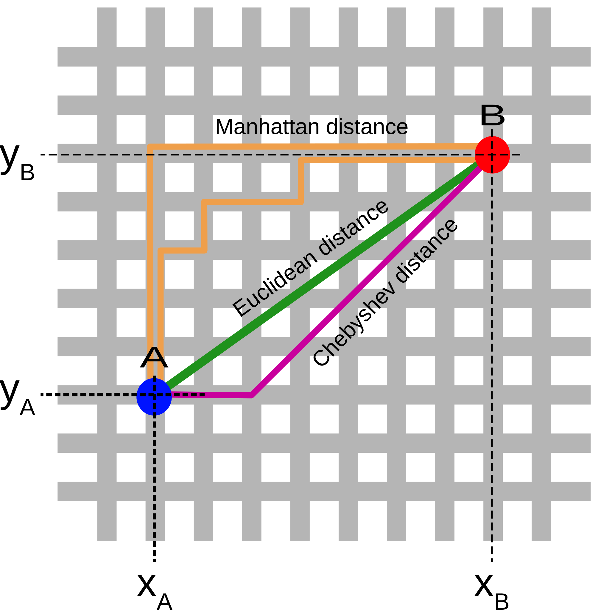
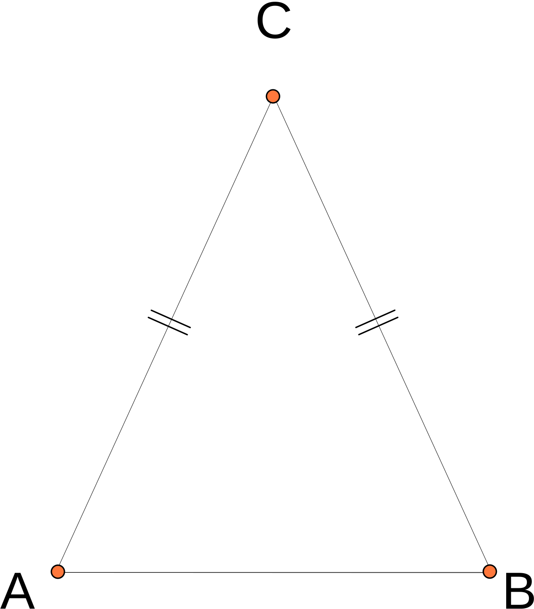
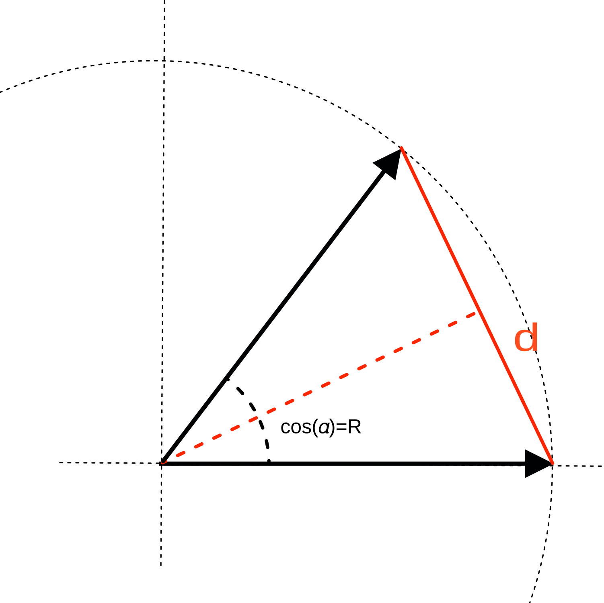

```{r setup, include=FALSE}
library(knitr) 
library(tidyverse)
library(kableExtra)
library(latex2exp)
library(MetabarSchool)

opts_chunk$set(echo = FALSE,
               cache = TRUE,
               cache.lazy = FALSE)
```

# Summary

-   The MetabarSchool Package
-   What do the reading numbers per PCR mean?
-   Rarefaction vs. relative frequencies
-   alpha diversity metrics
-   beta diversity metrics
-   multidimentionnal analysis
-   comparison between datasets

# The MetabarSchool Package

## Installing the package

You need the *devtools* package

```{r eval=FALSE, echo=TRUE}
install.packages("devtools",dependencies = TRUE)
```

Then you can install *MetabarSchool*

```{r  eval=FALSE, echo=TRUE}
devtools::install_git("https://git.metabarcoding.org/MetabarcodingSchool/biodiversity-metrics.git")
```

You will also need the *vegan* package

```{r eval=FALSE, echo=TRUE}
install.packages("vegan",dependencies = TRUE)
```

# The dataset

## The mock community {.flexbox .vcenter .smaller}

A 16 plants mock community

```{r}
data("plants.16")
x = cbind(` ` =seq_len(nrow(plants.16)),plants.16)
x$`Relative aboundance`=paste0('1/',1/x$dilution)
knitr::kable(x[,-(4:5)],
             format = "html", 
             row.names = FALSE,
             align = "rlrr")  %>% 
  kable_styling(position = "center")
```

## The experiment {.flexbox .vcenter}

```{r}
data("positive.samples")
```

-   `r nrow(positive.samples)` PCR of the mock community using SPER02 trnL-P6-Loop primers

    -   `r length(table(positive.samples$dilution))` dilutions of the mock community: `r paste0('1/',names(table(positive.samples$dilution)))`

    -   `r as.numeric(table(positive.samples$dilution)[1])` repeats per dilution

## Loading data

```{r echo=TRUE}
library(MetabarSchool)

data("positive.count")
data("positive.samples")
data("positive.motus")
```

-   `positive.count` read count matrix $`r nrow(positive.count)` \; PCRs \; \times \; `r ncol(positive.count)` \; MOTUs$

```{r}
knitr::kable(positive.count[1:5,1:5],
             format="html",
             align = 'rc') %>% 
  kable_styling(position = "center")  %>% 
  row_spec(0, angle = -45)
```

<br>

```{r echo=TRUE,eval=FALSE}
positive.count[1:5,1:5]
```

## Loading data

```{r echo=TRUE}
library(MetabarSchool)

data("positive.count")
data("positive.samples")
data("positive.motus")
```

-   `positive.samples` a `r nrow(positive.samples)` rows `data.frame` of `r ncol(positive.samples)` columns describing each PCR

```{r}
knitr::kable(head(positive.samples,n=3),
             format="html",
             align = 'rc') %>% 
  kable_styling(position = "center")
```

<br>

```{r echo=TRUE,eval=FALSE}
head(positive.samples,n=3)
```

## Loading data

```{r echo=TRUE}
library(MetabarSchool)

data("positive.count")
data("positive.samples")
data("positive.motus")
```

-   `positive.motus` : a `r nrow(positive.motus)` rows `data.frame` of `r ncol(positive.motus)` columns describing each MOTU

```{r}
knitr::kable(head(positive.motus,n=3),
             format = "html",
             align = 'rlrc') %>% 
  kable_styling(position = "center")
```

<br>

```{r echo=TRUE,eval=FALSE}
head(positive.motus,n=3)
```

## Removing singleton sequences {.flexbox .vcenter}

Singleton sequences are observed only once over the complete dataset.

```{r echo=TRUE,eval=FALSE}
table(colSums(positive.count) == 1)
```

```{r}
kable(t(table(colSums(positive.count) == 1)),
             format = "html") %>% 
  kable_styling(position = "center")   %>% 
  row_spec(0, align = 'c')
```

<br>

We discard them they are unanimously considered as rubbish.

```{r echo=TRUE}
are.not.singleton = colSums(positive.count) > 1
positive.count = positive.count[,are.not.singleton]
positive.motus = positive.motus[are.not.singleton,]
```

-   `positive.count` is now a $`r nrow(positive.count)` \; PCRs \; \times \; `r ncol(positive.count)` \; MOTUs$ matrix

## Not all the PCR have the same number of reads {.flexbox .vcenter}

Despite all standardization efforts

```{r fig.height=3}
par(bg=NA) 
hist(rowSums(positive.count),
     breaks = 15,
     xlab="Read counts",
     main = "Number of read per PCR")
```

::: green
Is it related to the amount of DNA in the extract ?
:::

## What do the reading numbers per PCR mean? {.smaller}

```{r echo=TRUE, fig.height=4}
par(bg=NA) 
boxplot(rowSums(positive.count) ~ positive.samples$dilution,log="y")
abline(h = median(rowSums(positive.count)),lw=2,col="red",lty=2)
```

```{r}
SC = summary(aov((rowSums(positive.count)) ~ positive.samples$dilution))[[1]]$`Sum Sq`
```

::: red2
<center>Only `r round((SC/sum(SC)*100)[1],1)`% of the PCR read count variation is explain by dilution</center>
:::

## You must normalize your read counts

Two options:

### Rarefaction

Randomly subsample the same number of reads for all the PCRs

### Relative frequencies

Divide the read count of each MOTU in each sample by the total total read count of the same sample

$$
\text{Relative fequency}(Motu_i,Sample_j) = \frac{\text{Read count}(Motu_i,Sample_j)}{\sum_{k=1}^n\text{Read count}(Motu_k,Sample_j)}
$$

```{r echo=TRUE,warning=FALSE,message=FALSE}
library(vegan)
```

## Rarefying read count (1) {.flexbox .vcenter}

-   We look for the minimum read number per PCR

```{r echo=TRUE}
min(rowSums(positive.count))
```

```{r echo=TRUE}
positive.count.rarefied = rrarefy(positive.count,2000)
```

## Rarefying read count (2) {.flexbox .vcenter}

```{r fig.height=4}
par(mfrow=c(1,2),bg=NA)
hist(log10(colSums(positive.count)+1),
     main = "Not rarefied",
     xlim = c(0,6),
     ylim = c(0,2300),
     breaks = 30,
     xlab = TeX("$\\log_{10}(reads per MOTUs)$"))
hist(log10(colSums(positive.count.rarefied)+1),
     main = "Rarefied data",
     xlim = c(0,6),
     ylim = c(0,2300),
     breaks = 30,
     xlab = TeX("$\\log_{10}(reads per MOTUs)$"))
```

## Rarefying read count (3) {.flexbox .vcenter}

Identifying the MOTUs with reads count greater than $0$ after rarefaction.

```{r echo=TRUE}
are.still.present = colSums(positive.count.rarefied)>0
are.still.present[1:5]
```

```{r echo=TRUE}
table(are.still.present)
```

## Rarefying read count (4) {.flexbox .vcenter}

```{r echo=TRUE, fig.height=3.5}
par(bg=NA) 
boxplot(colSums(positive.count) ~ are.still.present, log="y")
```

The MOTUs removed by rarefaction were at most occurring `r max(colSums(positive.count[,!are.still.present]))` times

The MOTUs kept by rarefaction were at least occurring `r min(colSums(positive.count[,are.still.present]))` times

## Rarefying read count (5) {.vcenter}

### Keep only sequences with reads after rarefaction

```{r echo=TRUE}
positive.count.rarefied = positive.count.rarefied[,are.still.present]
positive.motus.rare = positive.motus[are.still.present,]
```

<center>positive.motus.rare is now a $`r nrow(positive.count.rarefied)` \; PCRs \; \times \; `r ncol(positive.count.rarefied)` \; MOTUs$</center>

## Why rarefying ? {.vcenter .columns-2}

```{r, out.width = "200px"}

```

<br><br><br><br> Increasing the number of reads just increase the description of the subpart of the PCR you have sequenced.

## Transforming read counts to relative frequencies

```{r echo=TRUE}
positive.count.relfreq = decostand(positive.count,
                                   method = "total")
```

No sequences will be set to zero

```{r echo=TRUE}
table(colSums(positive.count.relfreq) == 0)
```

# Measuring diversity

## The different types of diversity {.vcenter}

::: {style="float: left; width: 40%;"}
```{r}

```
:::

::: {style="float: left; width: 60%;"}
<br><br> @Whittaker:10:00 <br><br><br><br>

-   $\alpha\text{-diversity}$ : Mean diversity per site ($species/site$)

-   $\gamma\text{-diversity}$ : Regional biodiversity ($species/region$)

-   $\beta\text{-diversity}$ : $\beta = \frac{\gamma}{\alpha}$ ($sites/region$)
:::

# $\alpha$-diversity

## Which is th most diverse environment ? {.flexbox .vcenter}

```{r out.width = "400px"}

```

```{r out.width = "400px"}
E1 = c(A=0.25,B=0.25,C=0.25,D=0.25,E=0,F=0,G=0)
E2 = c(A=0.55,B=0.07,C=0.02,D=0.17,E=0.07,F=0.07,G=0.03)
environments = t(data.frame(`Environment 1` = E1,`Environment 2` = E2))
kable(environments,
             format="html",
             align = 'rr') %>% 
  kable_styling(position = "center")
```

## Richness {.flexbox .vcenter}

The actual number of species present in your environement whatever their aboundances

```{r out.width = "400px"}

```

```{r echo=TRUE}
S = rowSums(environments > 0)
```

```{r}
kable(data.frame(S=S),
             format="html",
             align = 'rr') %>% 
  kable_styling(position = "center")
```

## Gini-Simpson's index {.smaller}

::: {style="float: left; width: 60%;"}
The Simpson's index is the probability of having the same species twice when you randomly select two specimens. <br> <br>
:::

::: {style="float: right; width: 40%;"}
$$
\lambda =\sum _{i=1}^{S}p_{i}^{2}
$$ <br>
:::

<center>

$\lambda$ decrease when complexity of your ecosystem increase.

Gini-Simpson's index defined as $1-\lambda$ increase with diversity

```{r out.width = "250px"}

```

</center>

```{r echo=TRUE}
GS = 1 - rowSums(environments^2)
```

```{r}
kable(data.frame(`Gini-Simpson`=GS),
             format="html",
             align = 'rr') %>% 
  kable_styling(position = "center")
```

## Shannon entropy {.smaller}

Shannon entropy is based on information theory:

<center>$H^{\prime }=-\sum _{i=1}^{S}p_{i}\log p_{i}$</center>

if $A$ is a community where every species are equally represented then $$
H(A) = \log|A|
$$

<center>

```{r out.width = "400px"}

```

</center>

```{r echo=TRUE}
H = - rowSums(environments * log(environments),na.rm = TRUE)
```

```{r}
kable(data.frame(`Shannon index`=H),
             format="html",
             align = 'rr') %>% 
  kable_styling(position = "center")
```

## Hill's number {.smaller}

::: {style="float: left; width: 50%;"}
As : $$
H(A) = \log|A| \;\Rightarrow\; ^1D = e^{H(A)}
$$ <br>
:::

::: {style="float: right; width: 50%;"}
where $^1D$ is the theoretical number of species in a evenly distributed community that would have the same Shannon's entropy than ours.
:::

<center>

<BR> <BR>

```{r out.width = "400px"}

```

</center>

```{r echo=TRUE}
D2 = exp(- rowSums(environments * log(environments),na.rm = TRUE))
```

```{r}
kable(data.frame(`Hill Numbers`=D2),
             format="html",
             align = 'rr') %>% 
  kable_styling(position = "center")
```

## Generalized logaritmic function {.smaller}

Based on the generalized entropy @Tsallis:94:00 we can propose a generalized form of logarithm.

$$
^q\log(x) = \frac{x^{(1-q)}-1}{1-q}
$$

The function is not defined for $q=1$ but when $q \longrightarrow 1\;,\; ^q\log(x) \longrightarrow \log(x)$

$$
^q\log(x) = \left\{ 
             \begin{align}
               \log(x),& \text{if } q = 1\\
               \frac{x^{(1-q)}-1}{1-q},& \text{otherwise}
             \end{align}
           \right.
$$

```{r echo=TRUE, eval=FALSE}
log_q = function(x,q=1) {
  if (q==1)
    log(x)
  else 
    (x^(1-q)-1)/(1-q)
}
```

## Impact of $q$ on the `log_q` function

```{r}
layout(matrix(c(1,1,2),nrow=1))
qs = seq(0,5,by=1)
x = seq(0.001,1,length.out = 100)
plot(x,log_q(x,0),lty=2,lwd=3,col=0,type="l",
     ylab = TeX("$^q\\log$"),
     ylim=c(-10,0))

for (i in seq_along(qs)) {
  points(x,log_q(x,qs[i]),lty=1,lwd=1,col=i,type="l")
}

points(x,log(x),lty=2,lwd=3,col="red",type="l")

plot(0,type='n',axes=FALSE,ann=FALSE)
legend("topleft",legend = qs,fill =  seq_along(qs),cex=1.5)


```

## And its inverse function {.flexbox .vcenter}

$$
^qe^x = \left\{ 
             \begin{align}
               e^x,& \text{if } x = 1 \\
               (1 + x(1-q))^{(\frac{1}{1-q})},& \text{otherwise}
             \end{align}
           \right.
$$

```{r echo=TRUE, eval=FALSE}
exp_q = function(x,q=1) {
  if (q==1)
    exp(x)
  else
    (1 + (1-q)*x)^(1/(1-q))
}
```

## Generalised Shannon entropy

$$
^qH = - \sum_{i=1}^S p_i \; ^q\log p_i
$$

```{r echo=TRUE, eval=FALSE}
H_q = function(x,q=1) {
  sum(x * log_q(1/x,q),na.rm = TRUE)
}
```

and generalized the previously presented Hill's number

$$
^qD=^qe^{^qH}
$$

```{r echo=TRUE, eval=FALSE}
 D_q = function(x,q=1) {
  exp_q(H_q(x,q),q)
}
```

## Biodiversity spectrum (1) {.flexbox .vcenter}

```{r echo=TRUE, eval=FALSE}
H_spectrum = function(x,q=1) {
  sapply(q,function(Q) H_q(x,Q))
}
```

```{r echo=TRUE, eval=FALSE}
D_spectrum = function(x,q=1) {
  sapply(q,function(Q) D_q(x,Q))
}
```

## Biodiversity spectrum (2)

```{r echo=TRUE,warning=FALSE,error=FALSE}
library(MetabarSchool)
qs = seq(from=0,to=3,by=0.1)
environments.hq = apply(environments,MARGIN = 1,H_spectrum,q=qs)
environments.dq = apply(environments,MARGIN = 1,D_spectrum,q=qs)
```

```{r}
par(mfrow=c(1,2),bg=NA)
plot(qs,environments.hq[,2],type="l",col="red", 
     xlab=TeX('$q$'),
     ylab=TeX('$^qH$'),
     xlim=c(-0.5,3.5),
     main="generalized entropy")
points(qs,environments.hq[,1],type="l",col="blue")
abline(v=c(0,1,2),lty=2,col=4:6)
plot(qs,environments.dq[,2],type="l",col="red", 
     xlab=TeX('$q$'),
     ylab=TeX('$^qD$'),
     main="Hill's number")
points(qs,environments.dq[,1],type="l",col="blue")
abline(v=c(0,1,2),lty=2,col=4:6)
```

## Generalized entropy $vs$ $\alpha$-diversity indices

-   $^0H(X) = S - 1$ : the richness minus one.

-   $^1H(X) = H^{\prime}$ : the Shannon's entropy.

-   $^2H(X) = 1 - \lambda$ : Gini-Simpson's index.

### When computing the exponential of entropy : Hill's number {.smaller}

-   $^0D(X) = S$ : The richness.

-   $^1D(X) = e^{H^{\prime}}$ : The number of species in an even community having the same $H^{\prime}$.

-   $^2D(X) = 1 / \lambda$ : The number of species in an even community having the same Gini-Simpson's index.

<br>

<center>

$q$ can be considered as a penality you give to rare species

**when** $q=0$ all the species have the same weight

</center>

## Biodiversity spectrum of the mock community

```{r echo=TRUE}
H.mock = H_spectrum(plants.16$dilution,qs)
D.mock = D_spectrum(plants.16$dilution,qs)
```

```{r}
par(mfrow=c(1,2),bg=NA)
plot(qs,H.mock,type="l",
     xlab=TeX('$q$'),
     ylab=TeX('$^qH$'),
     xlim=c(-0.5,3.5),
     main="generalized entropy")
abline(v=c(0,1,2),lty=2,col=4:6)
plot(qs,D.mock,type="l", 
     xlab=TeX('$q$'),
     ylab=TeX('$^qD$'),
     main="Hill's number")
abline(v=c(0,1,2),lty=2,col=4:6)
```

## Biodiversity spectrum and metabarcoding (1) {.smaller}

```{r echo=TRUE}
positive.H = apply(positive.count.relfreq,
                   MARGIN = 1,
                   FUN = H_spectrum,
                   q=qs)
```

```{r}
par(bg=NA) 
boxplot(t(positive.H),
        xlab=TeX('$q$'),
        ylab=TeX('$^qH$'),
        log="y",las=2,names=qs)
points(H.mock,col="red",type="l")
```

## Biodiversity spectrum and metabarcoding (2) {.flexbox .vcenter .smaller}

```{r}
par(bg=NA) 
boxplot(t(positive.H)[,11:31],
        xlab=TeX('$q$'),
        ylab=TeX('$^qH$'),
        log="y",
        names=qs[11:31])
points(H.mock[11:31],col="red",type="l")
positive.H.means = rowMeans(positive.H)

```

## Biodiversity spectrum and metabarcoding (3) {.smaller}

```{r echo=TRUE}
positive.D = apply(positive.count.relfreq,
                   MARGIN = 1,
                   FUN = D_spectrum,
                   q=qs)
```

```{r}
par(bg=NA) 
boxplot(t(positive.D),
        xlab=TeX('$q$'),
        ylab=TeX('$^qD$'),
        log="y",las=2,names=qs)
points(D.mock,col="red",type="l")

positive.D.means = rowMeans(positive.D)
```

## Impact of data cleaning on $\alpha$-diversity (1)

We realize a basic cleaning:

-   removing signletons
-   too short or long sequences
-   clustering data using `obiclean`

```{bash eval=FALSE,echo=TRUE}
obigrep -p 'count > 1' \
        positifs.uniq.annotated.fasta \
      > positifs.uniq.annotated.no.singleton.fasta

obigrep -l 10 -L 150 \
        positifs.uniq.annotated.no.singleton.fasta \
      > positifs.uniq.annotated.good.length.fasta

obiclean -s merged_sample -H -C -r 0.1 \
        positifs.uniq.annotated.good.length.fasta \
      > positifs.uniq.annotated.clean.fasta
```

## Impact of data cleaning on $\alpha$-diversity (2)

```{r echo=TRUE}
data(positive.clean.count)

positive.clean.count.relfreq = decostand(positive.clean.count,
                                         method = "total")

positive.clean.H = apply(positive.clean.count.relfreq,
                         MARGIN = 1,
                         FUN = H_spectrum,
                         q=qs)
```

```{r fig.height=3.5}
par(bg=NA) 
boxplot(t(positive.clean.H),
        xlab=TeX('$q$'),
        ylab=TeX('$^qH$'),
        log="y",las=2,names=qs)
points(H.mock,col="red",type="l")
```

## Impact of data cleaning on $\alpha$-diversity (3)

```{r echo=TRUE}
positive.clean.D = apply(positive.clean.count.relfreq,
                         MARGIN = 1,
                         FUN = D_spectrum,
                         q=qs)
```

```{r}
par(bg=NA) 
boxplot(t(positive.clean.D),
        xlab=TeX('$q$'),
        ylab=TeX('$^qD$'),
        log="y",las=2,names=qs)
points(D.mock,col="red",type="l")

positive.clean.D.means = rowMeans(positive.D)
```

# $\beta$-diversity

## Dissimilarity indices or non-metric distances {.flexbox .vcenter}

<center>A dissimilarity index $d(A,B)$ is a numerical measurement <br> of how far apart objects $A$ and $B$ are.</center>

### Properties

$$
\begin{align}
d(A,B) \geqslant& 0 \\
d(A,B) =& d(B,A) \\
d(A,B) =& 0 \iff A = B \\
\end{align}
$$

## Some dissimilarity indices

### Bray-Curtis

Relying on contengency table (quantitative data)

$$
{\displaystyle BC(A,B)=1-{\frac {2\sum _{i=1}^{p}min(N_{Ai},N_{Bi})}{\sum _{i=1}^{p}(N_{Ai}+N_{Bi})}}}, \; \text{with }p\text{ the total number of species}
$$

### Jaccard indices

Relying on presence absence data

$$
 J(A,B) = {{|A \cap B|}\over{|A \cup B|}} = {{|A \cap B|}\over{|A| + |B| - |A \cap B|}}.
$$

## Metrics or distances

::: {style="float: left; width: 50%;"}
```{r out.width = "400px"}

```
:::

::: {style="float: right; width: 50%;"}
A metric is a dissimilarity index verifying the *subadditivity* also named *triangle inequality*

$$
\begin{align}
d(A,B) \geqslant& 0 \\
d(A,B) =& \;d(B,A) \\
d(A,B) =& \;0 \iff A = B \\
d(A,B) \leqslant& \;d(A,C) + d(C,B)
\end{align}
$$
:::

## Some metrics

::::: columns
::: {.column width="40%"}
```{r out.width = "400px"}

```
:::

::: {.column width="60%"}
### Computing

$$
\begin{align}
d_e =& \sqrt{(x_A - x_B)^2 + (y_A - y_B)^2} \\
d_m =& |x_A - x_B| + |y_A - y_B| \\
d_c =& \max(|x_A - x_B| , |y_A - y_B|) \\
\end{align}
$$
:::
:::::

## Generalizable on a n-dimension space {.smaller}

Considering 2 points $A$ and $B$ defined by $n$ variables

$$
\begin{align}
A :& (a_1,a_2,a_3,...,a_n) \\
B :& (b_1,b_2,b_3,...,b_n)
\end{align}
$$

with $a_i$ and $b_i$ being respectively the value of the $i^{th}$ variable for $A$ and $B$.

$$
\begin{align}
d_e =& \sqrt{\sum_{i=1}^{n}(a_i - b_i)^2 } \\
d_m =& \sum_{i=1}^{n}\left| a_i - b_i \right| \\
d_c =& \max\limits_{1\leqslant i \leqslant n}\left|a_i - b_i\right| \\
\end{align}
$$

## For the fun... ;-) {.flexbox .vcenter}

You can generalize those distances as a norm of order $k$

$$
d^k = \sqrt[k]{\sum_{i=1}^n|a_i - b_i|^k}
$$

-   $k=1 \Rightarrow D_m$ Manhatan distance
-   $k=2 \Rightarrow D_e$ Euclidean distance
-   $k=\infty \Rightarrow D_c$ Chebychev distance

## Metrics and ultrametrics

::::: columns
::: {.column width="40%"}
```{r out.width = "400px"}

```
:::

::: {.column width="60%"}
### Metric

$$
d(x,z)\leqslant d(x,y)+d(y,z)
$$

### Ultrametric

$$
d(x,z)\leq \max(d(x,y),d(y,z))
$$
:::
:::::

## Why it is nice to use metrics ? {.flexbox .vcenter}

-   A metric induce a metric space
-   In a metric space rotations are isometries
-   This means that rotations are not changing distances between objects
-   Multidimensional scaling (PCA, PCoA, CoA...) are rotations

## The data set {.flexbox .vcenter}

**We analyzed two forest sites in French Guiana**

-   Mana : Soil is composed of white sands.

-   Petit Plateau : Terra firme (firm land). In the Amazon, it corresponds to the area of the forest that is not flooded during high water periods. The terra firme is characterized by old and poor soils.

**At each site, twice sixteen samples where collected over an hectar**

-   Sixteen samples of soil. Each of them is constituted by a mix of five cores of 50g from the 10 first centimeters of soil covering half square meter.

-   Sixteen samples of litter. Each of them is constituted by the total litter collecter over the same half square meter where soil was sampled

```{r echo=TRUE}
data("guiana.count")
data("guiana.motus")
data("guiana.samples")
```

## Clean out bad PCR cycle 1 {.flexbox .vcenter .smaller}

```{r echo=TRUE,fig.height=2.5}
s = tag_bad_pcr(guiana.samples$sample,guiana.count)
guiana.count.clean = guiana.count[s$keep,]
guiana.samples.clean = guiana.samples[s$keep,]
```

```{r echo=TRUE}
table(s$keep)
```

## Clean out bad PCR cycle 2 {.flexbox .vcenter .smaller}

```{r echo=TRUE,fig.height=2.5}
s = tag_bad_pcr(guiana.samples.clean$sample,guiana.count.clean)
guiana.count.clean = guiana.count.clean[s$keep,]
guiana.samples.clean = guiana.samples.clean[s$keep,]
```

```{r echo=TRUE}
table(s$keep)
```

## Clean out bad PCR cycle 3 {.flexbox .vcenter .smaller}

```{r echo=TRUE,fig.height=2.5}
s = tag_bad_pcr(guiana.samples.clean$sample,guiana.count.clean)
guiana.count.clean = guiana.count.clean[s$keep,]
guiana.samples.clean = guiana.samples.clean[s$keep,]
```

```{r echo=TRUE}
table(s$keep)
```

## Averaging good PCR replicates (1) {.flexbox .vcenter}

```{r echo=TRUE}
guiana.samples.clean = cbind(guiana.samples.clean,s[rownames(guiana.samples.clean),])

guiana.count.mean = aggregate(decostand(guiana.count.clean,method = "total"),
                              by = list(guiana.samples.clean$sample),
                              FUN=mean)

n = guiana.count.mean[,1]
guiana.count.mean = guiana.count.mean[,-1]
rownames(guiana.count.mean)=as.character(n)
guiana.count.mean = as.matrix(guiana.count.mean)

dim(guiana.count.mean)
```

## Averaging good PCR replicates (2) {.flexbox .vcenter}

```{r echo=TRUE}
guiana.samples.mean = aggregate(guiana.samples.clean,
                              by = list(guiana.samples.clean$sample),
                              FUN=function(i) i[1])
n = guiana.samples.mean[,1]
guiana.samples.mean = guiana.samples.mean[,-1]
rownames(guiana.samples.mean)=as.character(n)

dim(guiana.samples.mean)
```

### Keep only samples {.flexbox .vcenter}

```{r echo=TRUE}
guiana.samples.final = guiana.samples.mean[! is.na(guiana.samples.mean$site_id),]
guiana.count.final   = guiana.count.mean[! is.na(guiana.samples.mean$site_id),]
```

## Estimating similarity between samples {.flexbox .vcenter}

```{r echo=TRUE}
guiana.hellinger.final = decostand(guiana.count.final,method = "hellinger")
guiana.relfreq.final   = decostand(guiana.count.final,method = "total")
guiana.presence.1.final  = guiana.relfreq.final > 0.001
guiana.presence.10.final   = guiana.relfreq.final > 0.01
guiana.presence.50.final   = guiana.relfreq.final > 0.05

guiana.bc.dist = vegdist(guiana.relfreq.final,method = "bray")
guiana.euc.dist = vegdist(guiana.hellinger.final,method = "euclidean")
guiana.jac.1.dist = vegdist(guiana.presence.1.final,method = "jaccard")
guiana.jac.10.dist = vegdist(guiana.presence.10.final,method = "jaccard")
guiana.jac.50.dist = vegdist(guiana.presence.50.final,method = "jaccard")
```

## Euclidean distance on Hellinger transformation

```{r echo=TRUE,fig.height=3,fig.width=3}
xy = guiana.count.final[,order(-colSums(guiana.count.final))]
xy = xy[,1:2]
xy.hellinger = decostand(xy,method = "hellinger")
```

::::: columns
::: {.column width="40%"}
```{r, fig.width=4,fig.height=4}
par(bg=NA)
plot(xy.hellinger,asp=1)
```
:::

::: {.column width="60%"}
```{r out.width = "400px"}

```
:::
:::::

## Bray-Curtis distance on relative frequencies

$$
BC_{jk}=1-{\frac {2\sum _{i=1}^{p}min(N_{ij},N_{ik})}{\sum _{i=1}^{p}(N_{ij}+N_{ik})}}
$$

$$
BC_{jk}=\frac{\sum _{i=1}^{p}(N_{ij}+N_{ik})-\sum _{i=1}^{p}2\;min(N_{ij},N_{ik})}{\sum _{i=1}^{p}(N_{ij}+N_{ik})}
$$

$$
BC_{jk}=\frac{\sum _{i=1}^{p}(N_{ij} - min(N_{ij},N_{ik}) + (N_{ik} - min(N_{ij},N_{ik}))}{\sum _{i=1}^{p}(N_{ij}+N_{ik})}
$$

$$
BC_{jk}=\frac{\sum _{i=1}^{p}|N_{ij} - N_{ik}|}{\sum _{i=1}^{p}N_{ij}+\sum _{i=1}^{p}N_{ik}} 
$$

$$
BC_{jk}=\frac{\sum _{i=1}^{p}|N_{ij} - N_{ik}|}{1+1}
$$

$$
BC_{jk}=\frac{1}{2}\sum _{i=1}^{p}|N_{ij} - N_{ik}|
$$

## Principale coordinate analysis (1) {.flexbox .vcenter}

```{r echo=TRUE}
guiana.bc.pcoa  = cmdscale(guiana.bc.dist,k=3,eig = TRUE)
guiana.euc.pcoa = cmdscale(guiana.euc.dist,k=3,eig = TRUE)
guiana.jac.1.pcoa = cmdscale(guiana.jac.1.dist,k=3,eig = TRUE)
guiana.jac.10.pcoa = cmdscale(guiana.jac.10.dist,k=3,eig = TRUE)
guiana.jac.50.pcoa = cmdscale(guiana.jac.50.dist,k=3,eig = TRUE)
```

## Principale coordinate analysis (2)

```{r fig.height=5,fig.width=7.5}
samples.type = interaction(guiana.samples.final$Material,
                           guiana.samples.final$Site,
                           drop = FALSE)

par(mfrow=c(2,3),bg=NA)
plot(guiana.bc.pcoa$points[,1:2],
     col = samples.type,
     asp = 1,
     xlab="Axis 1",
     ylab="Axis 2",
     main = "Bray Curtis on Rel. Freqs")
plot(guiana.euc.pcoa$points[,1],-guiana.euc.pcoa$points[,2],
     col = samples.type,
     asp = 1,
     xlab="Axis 1",
     ylab="Axis 2",
     main = "Euclidean on Hellinger")
plot(0,type='n',axes=FALSE,ann=FALSE)
legend("topleft",legend = levels(samples.type),fill = 1:4,cex=1.2)
plot(guiana.jac.1.pcoa$points[,1:2],
     col = samples.type,
     asp = 1,
     xlab="Axis 1",
     ylab="Axis 2",
     main = "Jaccard on presence (0.1%)")
plot(-guiana.jac.10.pcoa$points[,1],guiana.jac.10.pcoa$points[,2],
     col = samples.type,
     asp = 1,
     xlab="Axis 1",
     ylab="Axis 2",
     main = "Jaccard on presence (1%)")
plot(guiana.jac.50.pcoa$points[,1:2],
     col = samples.type,
     asp = 1,
     xlab="Axis 1",
     ylab="Axis 2",
     main = "Jaccard on presence (5%)")

```

## Principale composante analysis {.flexbox .vcenter}

```{r echo=TRUE}
guiana.hellinger.pca = prcomp(guiana.hellinger.final,center = TRUE, scale. = FALSE)
```

```{r fig.height=4,fig.width=12}
par(mfrow=c(1,3),bg=NA)
plot(guiana.euc.pcoa$points[,1:2],
     col = samples.type,
     asp = 1,
     xlab="Axis 1",
     ylab="Axis 2",
     main = "Euclidean on Hellinger")
plot(guiana.hellinger.pca$x[,1:2],
     col = samples.type,
     asp = 1,
     xlab="Axis 1",
     ylab="Axis 2",
     main = "PCA on hellinger data")
plot(0,type='n',axes=FALSE,ann=FALSE)
legend("topleft",legend = levels(samples.type),fill = 1:4,cex=1.2)
```

````{=html}
<!---
## Computation of norms 

```{r guiana_norm, echo=TRUE}
guiana.n1.dist = norm(guiana.relfreq.final,l=1)
guiana.n2.dist = norm(guiana.relfreq.final^(1/2),l=2)
guiana.n3.dist = norm(guiana.relfreq.final^(1/3),l=3)
guiana.n4.dist = norm(guiana.relfreq.final^(1/100),l=100)
```

## pCoA on norms 

```{r dependson="guiana_norm"}
guiana.n1.pcoa  = cmdscale(guiana.n1.dist,k=3,eig = TRUE)
guiana.n2.pcoa  = cmdscale(guiana.n2.dist,k=3,eig = TRUE)
guiana.n3.pcoa  = cmdscale(guiana.n3.dist,k=3,eig = TRUE)
guiana.n4.pcoa  = cmdscale(guiana.n4.dist,k=3,eig = TRUE)
```

```{r}
par(mfrow=c(2,3),bg=NA)
plot(guiana.n1.pcoa$points[,1],guiana.n1.pcoa$points[,2],
     col = samples.type,
     asp = 1,
     xlab="Axis 1",
     ylab="Axis 2",
     main = "Norm 1 on Hellinger")
plot(guiana.n2.pcoa$points[,1],-guiana.n2.pcoa$points[,2],
     col = samples.type,
     asp = 1,
     xlab="Axis 1",
     ylab="Axis 2",
     main = "Norm 2 on Hellinger")
plot(0,type='n',axes=FALSE,ann=FALSE)
legend("topleft",legend = levels(samples.type),fill = 1:4,cex=1.2)
plot(-guiana.n3.pcoa$points[,1],-guiana.n3.pcoa$points[,2],
     col = samples.type,
     asp = 1,
     xlab="Axis 1",
     ylab="Axis 2",
     main = "Norm 3 on Hellinger")
plot(-guiana.n4.pcoa$points[,1],-guiana.n4.pcoa$points[,2],
     col = samples.type,
     asp = 1,
     xlab="Axis 1",
     ylab="Axis 2",
     main = "Norm 4 on Hellinger")

```

--->
````

## Comparing diversity of the environments

```{r}
guiana.relfreq.final = apply(guiana.relfreq.final,
                             MARGIN = 1,
                             FUN = H_spectrum,
                             q=qs)
```

```{r fig.width=9,fig.height=6}
par(mfrow=c(2,3),bg=NA)
boxplot(t(guiana.relfreq.final[,samples.type=="litter.Mana"]),log="y",
        names=qs,las=2,ylim=c(0.5,500),main = "Mana", xlab="q",
        ylab=TeX('$^qH$'))
boxplot(t(guiana.relfreq.final[,samples.type=="soil.Mana"]),log="y",
        names=qs,las=2,col=2,add=TRUE)
boxplot(t(guiana.relfreq.final[,samples.type=="litter.Petit Plateau"]),log="y",
        names=qs,las=2,col=3,ylim=c(0.5,500), main="Petit Plateau", xlab="q",
        ylab=TeX('$^qH$'))
boxplot(t(guiana.relfreq.final[,samples.type=="soil.Petit Plateau"]),log="y",
        names=qs,las=2,col=4,add=TRUE)
plot(0,type='n',axes=FALSE,ann=FALSE)
legend("topleft",legend = levels(samples.type),fill = 1:4,cex=1.5)
boxplot(t(guiana.relfreq.final[,samples.type=="litter.Mana"]),log="y",
        names=qs,las=2,ylim=c(0.5,500), main="Litter", xlab="q",
        ylab=TeX('$^qH$'))
boxplot(t(guiana.relfreq.final[,samples.type=="litter.Petit Plateau"]),log="y",
        names=qs,las=2,col=3,add=TRUE)
boxplot(t(guiana.relfreq.final[,samples.type=="soil.Mana"]),log="y",
        names=qs,las=2,col=2,ylim=c(0.5,500),main="Soil", xlab="q",
        ylab=TeX('$^qH$'))
boxplot(t(guiana.relfreq.final[,samples.type=="soil.Petit Plateau"]),log="y",
        names=qs,las=2,col=4,add=TRUE)
```

## Bibliography