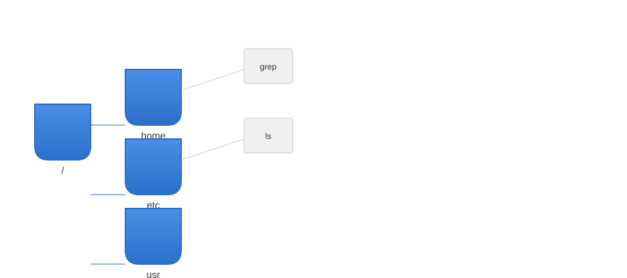
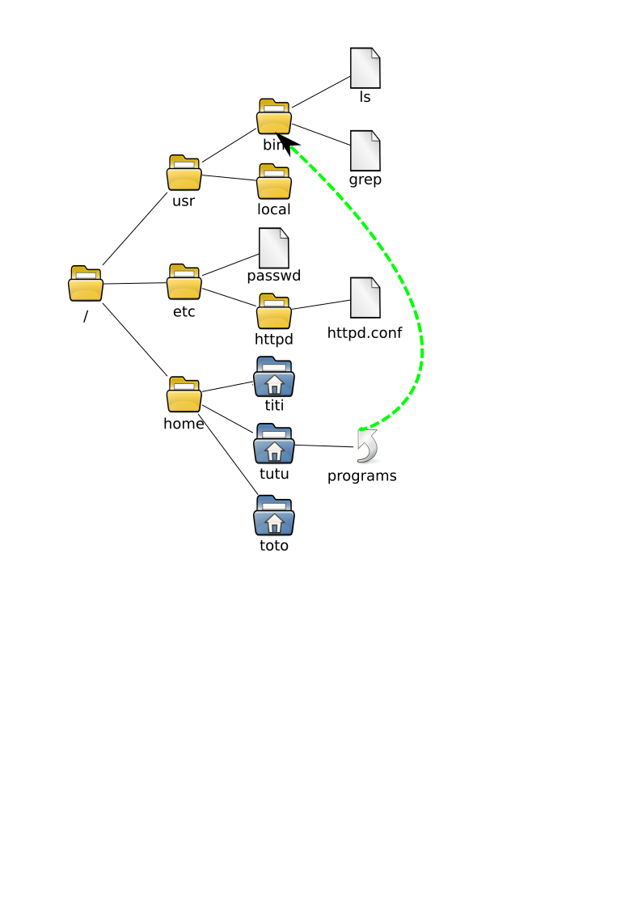
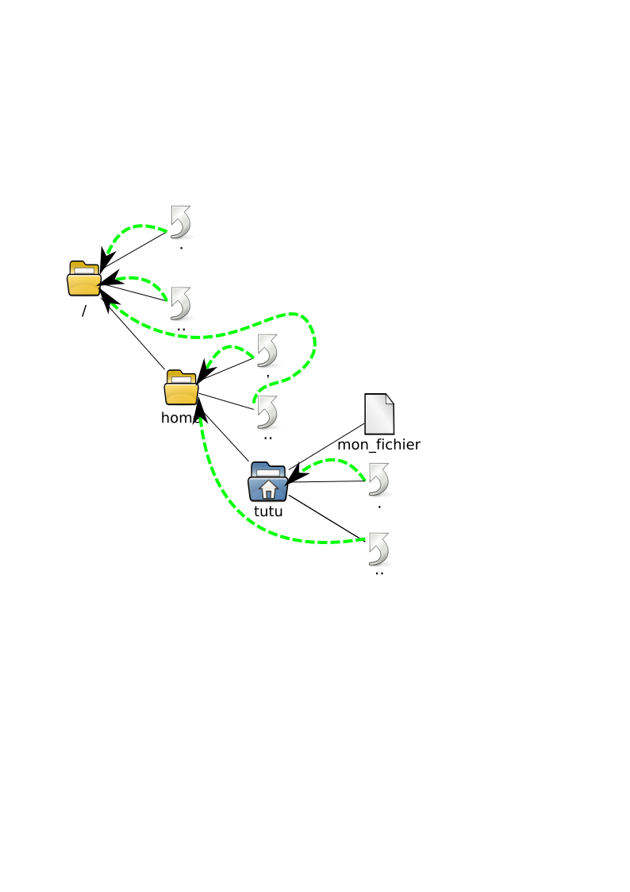
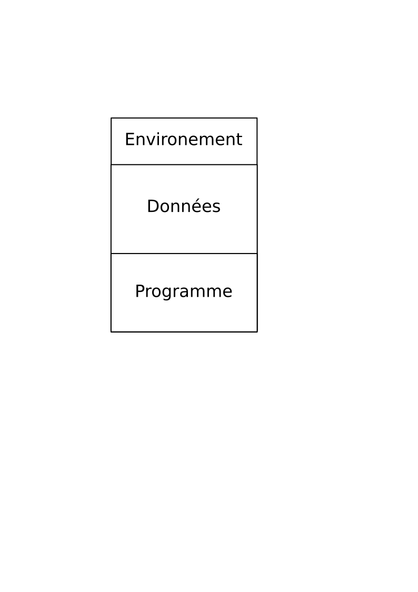
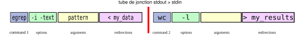

# Introduction to Unix

Unix is a family of operating systems and a set of design ideas—small programs that do one thing well, text as a universal interface, and easy composition through pipes. Those ideas power Linux servers, macOS, iOS, Android (via Linux), and most cloud infrastructure today. Learning Unix is learning the lingua franca of modern computing.

## Certified UNIX vs. Unix‑like

“UNIX” is a trademark of The Open Group for systems that pass the POSIX/SUS conformance tests. macOS is certified; Linux distributions and BSDs are “Unix‑like”—they follow the same model and standards. For our purposes, you can treat them similarly.

> This course uses **bash** exclusively. Commands and syntax target modern GNU/*BSD/macOS shells and core utilities. When an option is GNU‑specific, we’ll note it.

# Users and Accounts

Each person has a **user account** (username/login) with a numeric **UID**, a **primary group**, a **home directory**, and a **default shell**. User account metadata lives in `/etc/passwd` (user list) and `/etc/shadow` (password hashes, not world‑readable).

```{bash}
#| label: ex-passwd-head
#| eval: false
#| caption: Inspecting the user database (first lines of /etc/passwd).
head -15 /etc/passwd
```

# The Unix File System

The filesystem is a single rooted hierarchy (`/`). Directories are nodes; files are leaves; symbolic links add extra edges (making it a DAG).

{style="display:block;margin:0;padding:0;" fig-cap="A simplified Unix filesystem tree. The highlighted path resolves to `/etc/passwd`." #fig-fs-unix}

Common top‑level directories:

- `/etc` – system configuration
- `/var` – variable state (logs, spool, caches)
- `/bin`, `/usr/bin` – essential and additional executables
- `/usr`, `/usr/local` – the main system and locally installed software
- `/home` (or `/Users` on macOS) – user homes

## Filenames and Rules

- Case matters: `Foo.txt` ≠ `foo.txt`.
- Avoid spaces and exotic punctuation in names; prefer letters, digits, `. - _`.
- Names starting with `.` are “hidden” (e.g., `~/.bashrc`).

## Links

Two kinds of links:

- **Hard link**: an additional directory entry pointing to the same inode (same file). Cannot span filesystems; not for directories (with rare admin exceptions).
- **Symbolic link**: a small file that points to a path (can cross filesystems).

{fig-cap="Symbolic link creates an extra path to the same target." #fig-fs-link}

## `.` and `..`

Every directory contains entries `.` (itself) and `..` (parent). They make relative navigation and scripting concise.

{fig-cap="Special entries `.` and `..` help navigate without absolute paths." #fig-fs-spdir}

## Current Working Directory and Relative Paths

Your **current working directory** (CWD) is where relative paths are resolved. Use `pwd` to show it and `cd` to change it.

```{bash}
#| eval: false
pwd
cd /usr
pwd
cd -    # jump back
```

## Permissions (Mode), Ownership, and Umask

Each file has an **owner** (user), a **group**, and three permission triplets (r,w,x) for **user**, **group**, and **others**:

```{bash}
#| eval: false
# long listing shows mode, owner, group, size, date, name
ls -l /bin/bash
# change permissions: add user execute, remove group write
chmod u+x,g-w script.sh
# change owner/group (requires privileges)
sudo chown alice:science data.tsv
# show and set default creation mask
umask         # e.g., 0022
umask 0002    # collaborative group-writable defaults
```

# Processes

A **program** is code on disk; a **process** is a running instance with its own memory, environment, and open file descriptors. Each process has a **PID** and a **PPID** (parent PID).

```{bash}
#| eval: false
ps aux | head -5
pstree -a | head -20   # on macOS: brew install pstree; or use 'pgrep -lf .'
```

## The Process “Anatomy”

- **Code** (the program image)
- **Data/Heap/Stack**
- **Environment** (variables like `PATH`, `HOME`)
- **Standard streams**: `stdin` (0), `stdout` (1), `stderr` (2)

{fig-cap="A process has code, data, environment, and standard streams." #fig-process-anatomy}

## Lifecycle and Inheritance

Processes are created by **fork/exec**. Children inherit the parent’s environment and open descriptors unless changed. When a child exits, it becomes a **zombie** until the parent reaps it.

```{mermaid}
%%| echo: false
%%| code-fold: false
graph TD
A["Parent process"] -->|fork| B["Child (COW)"]
B -->|exec| C["New program image"]
C -->|exit| D{Parent waits}
D -- yes --> E["Child reaped"]
D -- no --> F["Zombie until parent waits"]
```

# The Shell (bash)

The shell is a command interpreter and a scripting language. We’ll use **bash** only.

## Structure of a Command Line

```text
command [OPTIONS...] [ARGUMENTS...] [REDIRECTIONS/PIPES]
```

- **Command**: executable name or path
- **Options**: short `-l` or long `--long`
- **Arguments**: files, patterns, values
- **Redirections/Pipes**: `>`, `>>`, `<`, `2>`, `|`, `|&`, `<<<`

```{bash}
#| label: ex-path
#| caption: PATH lists directories searched for commands, left to right.
echo "$PATH"
command -v bash   # show full path to the executable bash will run
```

If a program isn’t on `PATH`, run it via a path (absolute or relative):

```{bash}
#| eval: false
./mytool --help
/home/alice/bin/mytool --version
```

## Modern Note on `grep`

`egrep` and `fgrep` are deprecated. Use `grep -E` (extended regex) and `grep -F` (fixed strings).

```{bash}
#| eval: false
grep -E 'root|daemon' /etc/passwd
grep -Fi 'error' /var/log/system.log
```

# Globs (Filename Patterns)

The shell expands patterns **before** running the command:

| Pattern | Meaning |
|---|---|
| `*` | any string (including empty) |
| `?` | any single char |
| `[abc]` | any of listed chars |
| `{a,b,c}` | brace expansion (not a glob; bash feature) |

```{bash}
#| eval: false
echo *.txt
ls -ld /[uv]??
printf '%s\n' project/{data,docs,src}
```

# Redirection and Pipes

Standard streams: `stdin` (0), `stdout` (1), `stderr` (2).

{fig-cap="Default streams: keyboard → stdin; stdout/stderr → terminal." #fig-shell-inoutput}

## Redirect to/From Files

```{bash}
#| eval: false
ls / > listing.txt           # stdout to file (overwrite)
ls / >> listing.txt          # append
grep -E 'log' < listing.txt  # stdin from file
grep -E 'log' listing.txt > matches.txt 2> errors.log
```

## Pipelines

`|` connects stdout of left command to stdin of right command. Use `|&` to pipe both stdout and stderr (bash).

{fig-cap="A two‑stage pipeline: stdout of cmd1 becomes stdin of cmd2." #fig-commande-tube}

```{bash}
#| eval: false
ls -l /usr/bin | head -n 5
journalctl -u ssh |& grep -Ei 'fail|error'   # GNU/Linux
```

{fig-cap="Redirecting `ls` output into a file." #fig-ls-stdout}
{fig-cap="Regular file."}
{fig-cap="Directory."}
{fig-cap="Home directory icon."}
{fig-cap="Regular file (again, for legend grouping)."}
{fig-cap="Symbolic link (legend)."}

# Loops, Variables, and Scripting

## Variables

Create with `name=value`. Read with `$name`. Export to children with `export name`.

```{bash}
#| label: ex-vars
greeting="hello world"
echo "$greeting"
export PATH="$HOME/bin:$PATH"
```

## `for` Loops

```{bash}
#| eval: false
for f in /var/log/*.log; do
  echo "Checking: $f"
  grep -Eci 'error|warning' "$f"
done
```

## Safer Bash

- Always quote expansions: `"$var"`
- Enable strict mode in scripts:
  ```bash
  set -Eeuo pipefail
  IFS=$'\n\t'
  ```
- Prefer `mktemp` for temp files
- Use `printf` instead of `echo` for exact output

## Color‑Blind‑Friendly Tips

Use **shapes**, **labels**, and **line styles** rather than relying solely on color in outputs and diagrams. In Mermaid use dashed/solid edges and different node shapes:

```{mermaid}
%%| echo: false
%%| code-fold: false
flowchart LR
  classDef solid stroke-width:2;
  classDef dashed stroke-dasharray: 5 5, stroke-width:2;
  A([File]):::solid --> B{{Grep}}:::dashed
  B --> C[[Matches]]
```

# Essential Commands (Modernized, Bash‑centric)

Below are concise prototypes. Use `--help` and `man` for details.

## `awk` — Pattern scanning and processing

```bash
awk [-F SEP] 'PROGRAM' [FILE...]
```

- `-F` field separator. Example: `awk -F: '{print $1,$3}' /etc/passwd`

## `bash` — The shell

```bash
bash            # start a new interactive shell
bash script.sh  # run a script
```

## `bg` / `fg` / `jobs` — Job control

```bash
sleep 60 &   # run in background
jobs         # list jobs
fg %1        # bring job 1 to foreground
bg %1        # resume job 1 in background
```

## `cat` — Concatenate files

```bash
cat file1 [file2 ...] > out
```

## `cd` — Change directory

```bash
cd [DIR]   # no arg: go to $HOME
```

## `chmod` — Change permissions

```bash
chmod [-R] MODE FILE...
chmod u+rwx,g+rx,o-rwx FILE
```

## `chsh` — Change login shell

```bash
chsh -s /bin/bash
```

## `cp` — Copy files

```bash
cp [-R] SRC... DEST
```

## `diff` — Text diffs

```bash
diff -u old.txt new.txt | less
```

## `env` / `export` — Environment

```bash
env | sort
export VAR=value
```

## `grep` — Search text (replaces `egrep`/`fgrep`)

```bash
grep [-E|-F] [-iR] PATTERN [FILE...]
```

## `head` / `tail` — File ends

```bash
head -n 20 FILE
tail -n 50 FILE
tail -f /var/log/syslog   # follow
```

## `join` — Join lines on a field

```bash
join -1 1 -2 1 file1 file2
```

## `kill` — Send signals

```bash
kill -SIGTERM PID
kill -9 PID      # last resort
kill -l          # list signals
```

## `ln` — Create links

```bash
ln FILE LINKNAME       # hard link
ln -s TARGET LINKNAME  # symlink
```

## `ls` — List files

```bash
ls -la
ls -ltrh /var/log
```

## `man` — Manuals

```bash
man ls
man -k network    # search by keyword
```

## `mkdir` — Make directories

```bash
mkdir -p project/{data,docs,src}
```

## `mv` — Move/rename

```bash
mv old new
mv file*.txt dir/
```

## `paste` — Merge lines side by side

```bash
paste file1 file2
```

## `ps` — Process status

```bash
ps aux | grep -E '[n]ginx'
ps -U "$USER" -o pid,ppid,stat,cmd
```

## `pwd` — Current directory

```bash
pwd
```

## `rm` — Remove files (dangerous)

```bash
rm [-rf] PATH...
```

> Tip: Use `trash`/`gio trash` on desktops when possible.

## `sed` — Stream editor

```bash
sed -E 's/old/new/g' FILE
```

## `sort` / `uniq` — Sorting and deduping

```bash
sort -u names.txt
sort -k2,2n data.tsv | uniq -c
```

## `wc` — Counts

```bash
wc -lwc FILE
```

# Practice: Putting It Together

```{bash}
#| eval: false
# Find the 10 most common failed SSH sources today (GNU/Linux example)
journalctl -u ssh --since today \
| grep -Ei 'failed|authentication failure' \
| awk '{print $(NF)}' \
| sort | uniq -c | sort -k1,1nr | head -10
```

